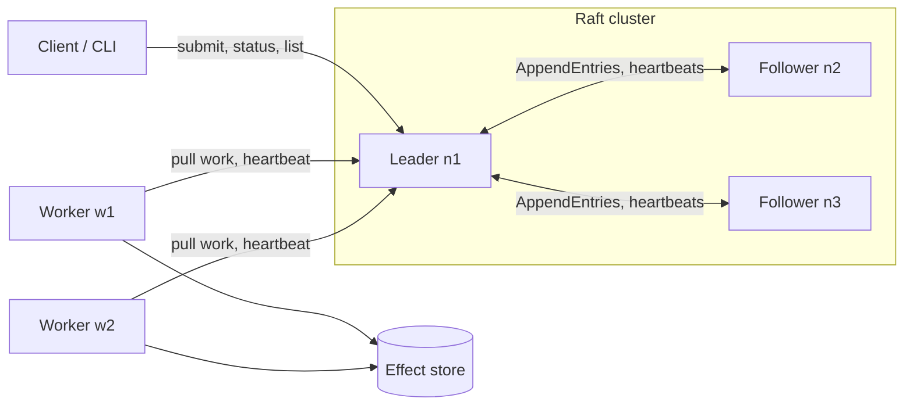
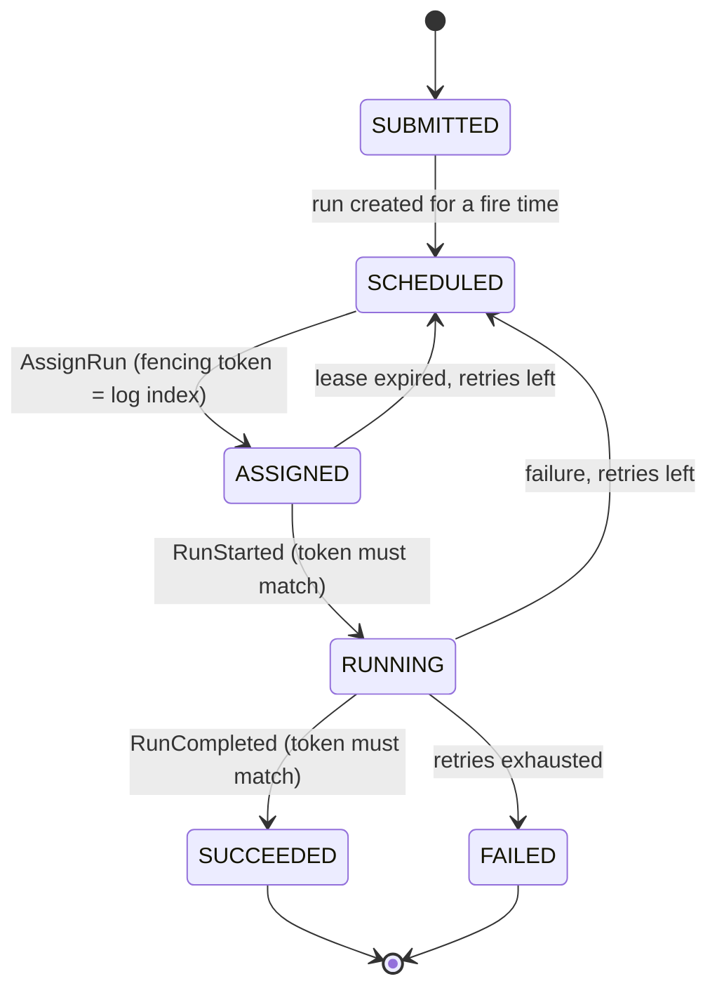
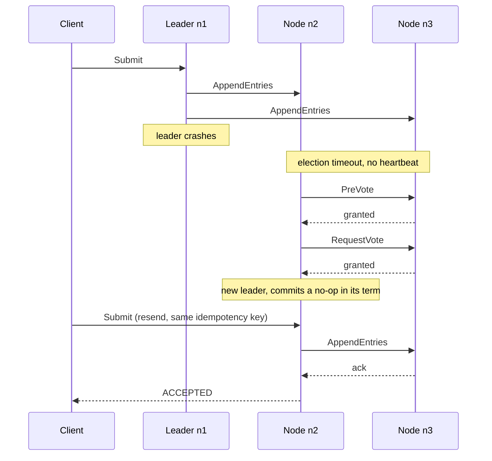

# Fault-Tolerant Distributed Job Scheduler

A job scheduler that keeps working when machines fail. It runs on 3 to 5 nodes, replicates its state with a Raft implementation written from scratch in Java 21 (no consensus library), and uses gRPC between nodes, workers and clients.

The guarantee is **exactly-once effects**, not exactly-once delivery. Delivery is at-least-once. Each run carries an idempotency key and a fencing token, and a replicated completion record means a retried or stale worker cannot produce a second effect. `docs/design.md` explains why exactly-once delivery is impossible and what this system guarantees instead.

## What is in it

- **Raft from scratch**: randomized elections with PreVote and CheckQuorum, log replication with conflict-hint backtracking, commit only of current-term entries, a durable log (CRC32 records, torn-write recovery), snapshots with InstallSnapshot, dynamic membership (single-server changes plus non-voting learners), and ReadIndex reads.
- **Scheduler state machine**: one-shot and cron jobs, runs with retries, worker leases, a misfire policy, idempotency keys, and fencing tokens (the log index of the assignment entry).
- **Client library and CLI**: submit, status, cancel, list and member changes. The client finds the leader, follows hints and retries across leader changes.
- **Seeded chaos harness**: drop, delay, duplicate and reorder messages, partitions (including leader isolation), node and worker crashes, long worker pauses, and membership changes, with checkers for lost jobs, duplicate effects, log agreement, election safety and read freshness.
- **Real runtime**: gRPC transport, files on disk, and a benchmark command.

## Architecture



Each node is a single-threaded, event-driven state machine (tick, receive, propose) with no internal clock or threads. That is what lets the same code run under a seeded simulated network in tests and under gRPC in production.

## Job lifecycle



## Leader failover



## Build and run

Requirements: Java 21 and Maven 3.9 or newer.

```
mvn -B package -DskipTests
```

Start a 3-node cluster (one terminal each; data directories are created as needed):

```
CLUSTER=n1=127.0.0.1:7001,n2=127.0.0.1:7002,n3=127.0.0.1:7003
bin/djs node --id n1 --cluster $CLUSTER --data /tmp/djs/n1
bin/djs node --id n2 --cluster $CLUSTER --data /tmp/djs/n2
bin/djs node --id n3 --cluster $CLUSTER --data /tmp/djs/n3
bin/djs worker --id w1 --cluster $CLUSTER
```

Use the CLI:

```
export DJS_CLUSTER=$CLUSTER
bin/djs submit --handler effect --in 5 --id demo-1
bin/djs status demo-1
bin/djs list
bin/djs member list
```

Built-in handlers are `effect` and `fail`. Re-running a submit with the same `--id` never creates a second job (the job id is the idempotency key unless `--key` is given). Jobs can also use `--at EPOCH_MILLIS` or `--cron "* * * * *"`, and `--attempts N`.

## Tests

```
mvn -B verify
```

167 tests, 0 failures on the author's machine. One compaction test takes about 45 seconds because it fsyncs heavily. CI runs the same command on every push.

Larger chaos sweeps are controlled by system properties on the test run (`-Dchaos.seeds=1000` for the Raft harness, `-Dschedchaos.seeds=1000` for the scheduler harness, `-Dmembership.seeds=1000`, `-DsnapshotChaos.scenarios=1000`). A failing seed is printed and replays exactly.

## Results

### Correctness: chaos sweeps (simulated network, 1,000 scenarios per harness, seeds 1 to 1000)

All four harnesses finished with **0 failed scenarios**.

| Harness | Notable counts |
|---|---|
| Raft | 85,306 proposals, 83,187 committed, 43,883 crashes, 43,801 partitions, 17,685 elected terms |
| Scheduler | 135,814 jobs submitted, 134,155 acked, 134,155 succeeded with exactly one effect; 34,981 node crashes, 30,804 worker crashes, 40,743 worker pauses, 36,185 partitions; 1,531,033 read requests, 186,427 answered |
| Scheduler with snapshots | 134,155 jobs succeeded, 123,742 snapshots taken, 29,833 installed |
| Membership | 93,477 proposals, 93,175 committed, 50,438 crashes, 38,798 partitions; 9,821 learners added, 5,318 promotions, 8,916 removals |

As a negative control, the same harness with a deliberately naive effect store (no per-run dedupe) produces duplicate effects in 59 of 60 seeds, and the real store in none.

### Performance: benchmarks on one laptop

Hardware: Apple M4, 10 cores, 16 GB RAM, macOS 15.5, Java 21.0.13, max heap 4 GB. All nodes, 32 workers and the client threads run in **one JVM** with real gRPC on localhost and files on disk, so these numbers describe a single machine and not a network. Tick 20 ms (election timeout 200 to 380 ms, heartbeat 40 ms). Command: `bin/djs bench --rate 20 --seconds 10 --jobs 2000 --trials 5`.

| Measure | 3 nodes | 5 nodes |
|---|---|---|
| Submit to execution start at 20 jobs/s, p50 | 74.6 ms | overloaded (6.9 s) |
| Submit to execution start at 20 jobs/s, p99 | 116.0 ms | overloaded (18.2 s) |
| Flood of 2,000 jobs: committed submits per second | 52.6 | 49.0 |
| Flood of 2,000 jobs: jobs per second end to end | 47.8 | 39.3 |
| Kill leader to new leader, median (5 trials) | 241.6 ms | 305.4 ms |
| Kill leader to first committed write, median | 915.3 ms | 926.1 ms |
| Acked jobs not executed / duplicate effects | 0 / 0 | 0 / 0 |

Read these honestly:
- Latency is measured from the intended send time, which avoids coordinated omission.
- The first-write time includes the client's 15-tick resend interval.
- Throughput is not stable. Three 3-node floods on the same machine gave 47.8, 49.8 and 87.7 jobs/s end to end. I did not find the cause.
- At 5 nodes the cluster saturated at 20 jobs/s in this single-JVM setup. A thread-dump profile showed time in fsync and gRPC decoding and no scan over all jobs, but I did not diagnose the 5-node result further.
- A 50 jobs/s latency run overloaded the cluster (p50 4.9 s at 3 nodes) and is not reported as a latency figure.
- Every benchmark run, at both sizes, ended with 0 lost and 0 duplicate effects.

## Limitations

- **Group commit is not covered by the chaos runs.** Group commit (one fsync per batch, outgoing messages held until it completes) is tested by real-file and gRPC tests and checked by the benchmark integrity counts, but the seeded simulated runs do not exercise it.
- **Snapshots are sent whole.** InstallSnapshot is one message; chunked transfer is not implemented.
- **Single Raft group.** Throughput is bounded by one leader and fsync latency. `docs/design.md` section 11 covers how it would shard and what changes across datacenters.
- **fsync semantics.** The log uses Java `FileChannel.force`. I did not test power-loss behavior on macOS hardware, so durability is argued from the code and the crash tests, not measured against real power loss.
- **Housekeeping scan.** The leader's housekeeping iterates all runs every 2 ticks (linear in the number of runs).
- **Standalone worker.** `WorkerMain` uses an in-memory effect store. The exactly-once checks run against the shared store used by the harness and the benchmark.
- **Single-machine benchmarks.** See above; no multi-machine measurements were taken.

## Design

`docs/design.md` has the full design: the Raft details, the scheduler state machine, the exactly-once argument, the testing strategy, the bugs the harness caught, limitations and a decision log.

## How AI tools were used

Most of the code, tests and documentation in this repository were written by Claude (Anthropic) in a long chat session, step by step. The author directed the work, chose the scope and the design trade-offs, ran every build, test sweep and benchmark on their own machine, and approved the design document. The author does not claim to have typed the code. The things that went wrong are listed because they show where AI-written code needed checking:

1. **The first effect store was wrong.** The AI's first design only rejected lower fencing tokens, which still allows two effects from a paused stale worker and its retry. A review of the design caught it; the fix was per-run dedupe plus the token check.
2. **A test suite had a gap that mutation testing exposed.** A deliberate bug in PreVote survived the AI's election tests. A direct test was added.
3. **A run got stuck in ASSIGNED.** A one-shot Started message went to a follower and was never retried. The fix was to let the first valid heartbeat propose it.
4. **A retried submit was reported as a duplicate failure over real gRPC.** The client now treats DUPLICATE on a retried request for the same job id as success.
5. **A membership liveness bug.** The membership chaos harness found 7 of 200 seeds with no leader after healing, caused by vote refusal based on stale configurations. The fix changed the voting rule.
6. **A read check that was too weak.** A ReadIndex mutant passed two versions of the AI's chaos read check. It was only caught after adding a timer-stall fault (119 of 200 seeds then failed).
7. **A performance bug found by profiling.** The first benchmark flood ran at 3.2 submits per second. The AI's first hypothesis (slow fsync) was disproved by a direct test, thread dumps showed every node blocked in `force`, and group commit fixed it.

The AI also wrote this README. The numbers in it come from the logs of runs on the author's Mac, not from memory, and the AI could not run Maven in its own workspace, so every result here was produced on that machine.

## License

MIT. See `LICENSE`.
